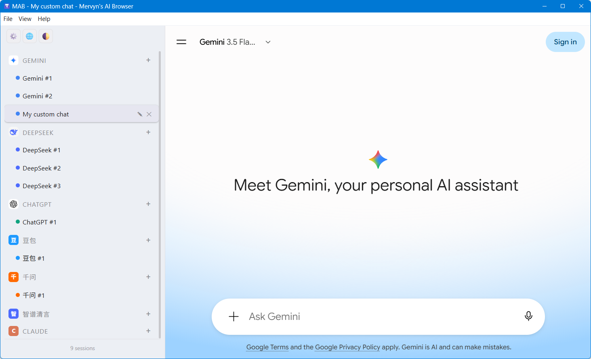
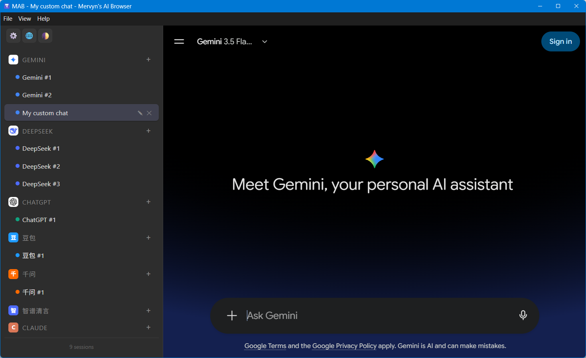

[English](README.md) · [中文](README.zh-CN.md)

# Mervyn's AI Browser

A multi-session AI browser built with Electron. Open Gemini, DeepSeek, ChatGPT, Doubao, Qwen, Zhipu AI, and Claude side by side in isolated, persistent sessions.

English is the default UI language.

## Screenshot

**Light mode**



**Dark mode**



## Features

- **Multi-session tabs** — Create multiple sessions per AI service; each session keeps its own page state while sharing the service's login.
- **Persistent login** — Every service runs in its own Electron `persist:` partition, so login state survives restarts and closing a tab (same machine).
- **Session & workspace restore** — Tabs, active tab, window size, sidebar width, bookmarks and the service list all come back on the next launch.
- **Toolbar bookmarks** — Keep frequently used sites (e.g. daily check-ins) one click away. Closing the tab keeps both the bookmark and its login state.
- **User-configurable AI services** — The sidebar list is not hardcoded: add, rename, remove and reorder services in `Manage AI Services`, or edit `services.json` directly (changes apply live, no restart).
- **In-page search** — `Ctrl+F` opens a floating find bar with a match counter and next/previous navigation. It is scoped to the app and never takes over the system-wide shortcut.
- **Pronunciation & read-aloud** — Select a word and right-click for IPA/phonetics, part of speech and audio; read any selection aloud with the built-in Edge neural TTS.
- **Custom toolbar & menus** — A 30px toolbar with `File / View / Help`, arbitrary web pages as tabs, and back / forward / reload / zoom / DevTools.
- **Themes & languages** — Light/dark themes that sync across every view; English/Chinese UI.
- **Cache management** — See how much disk the tab partitions occupy and clean HTTP/code caches plus orphaned partitions without touching login state.
- **Proxy support** — Follows the system proxy by default (Clash / TUN mode); override with the `AI_BROWSER_PROXY` environment variable.
- **Auto-launch** — Optional "Launch at startup" toggle in Settings.
- **Resilient loading** — Transient network errors are retried automatically, and renderer crashes recover by reloading.
- **Update check** — Silent check on launch with a sidebar badge, plus `Help → Check for Updates`.

## Development

```bash
npm install
npm start          # run in development mode (electron .)
```

## Build

```bash
npm run dist       # build installer -> dist/Mervyn's AI Browser Setup x.x.x.exe
npm run pack       # build unpacked directory only -> dist/win-unpacked/
```

The build output goes to `dist/` as an NSIS installer (selectable install directory, desktop + start menu shortcuts).

### Running an isolated instance (clean profile)

Set `MAB_USER_DATA` before launching to run MAB with completely separate data — sessions, login
state, bookmarks, services and caches all live in that directory, so the normal profile is
untouched. Handy for demos, testing, or a "guest" profile:

```powershell
$env:MAB_USER_DATA = "D:\mab-demo"
npm start
```

Delete the directory to reset the instance to a brand-new state.

## Data location

User data (tabs, login state) is stored at:

```
C:\Users\<username>\AppData\Roaming\MyAIBrowser
```

- Reinstalling or restarting on the same PC keeps tabs and login state.
- Moving to another PC requires re-login (Windows encrypts cookies per machine).

## Settings

Open **Settings** from the gear icon at the top of the sidebar:

| Option | Description |
| --- | --- |
| Launch at startup | Add the app to the system login items. |
| Language | Switch the UI between English and Chinese. |
| Theme | Light / Dark, applied to every view immediately. |
| Cache | Show how much disk the tab partitions occupy, and clean HTTP/code caches plus orphaned partitions (login state is preserved). |
| Manage AI Services… | Open the service manager: add / rename / edit URLs / remove / reorder. |

> **Proxy** is not set in the UI. Configure it through the environment variable below.

## Proxy configuration

By default the app follows the system proxy (e.g. Clash's "System Proxy" / TUN mode), and the rules apply to every tab. Optionally set the `AI_BROWSER_PROXY` environment variable before launching to override it with explicit rules:

```bash
# Windows (PowerShell)
$env:AI_BROWSER_PROXY = "http=127.0.0.1:7890;https=127.0.0.1:7890"
npm start
```

## Managing AI services

The sidebar service list is user-configurable and stored in `services.json` inside the user data directory (`%APPDATA%\MyAIBrowser\services.json` on Windows). It is the single source of truth: the sidebar, the `File > New Session` menu and per-service login partitions are all derived from it.

- **In-app editor**: open `Settings` (gear icon) and click `Manage AI Services…` to add, rename, remove or drag-to-reorder services. Changes apply immediately.
- **Manual editing**: use `File > Open services.json` to open the file in your editor; saved changes are picked up live, no restart needed. Each entry looks like this:

| Field | Description |
| --- | --- |
| `key` | Stable identifier (also names the login partition). Auto-generated for new services. |
| `name` | Display name (also used as the default tab name). |
| `url` | Home URL loaded for the service. |
| `icon` | Optional short text badge shown in the sidebar (defaults to the first letter of `name`). |
| `color` | Brand color for the sidebar badge. |
| `logo` | Optional path to a logo image (`assets/logos/<name>.png`). |

Removing a service that still has open sessions asks for confirmation: its tabs disappear on the next launch, while its login data stays on disk (cleanable in `Settings > Cache`).

Service logos live in `assets/logos/`. The app icon (`assets/icon.ico`) takes effect after rebuild.

To regenerate the icon, run `python gen_icon.py` (writes `assets/icon.ico`).

## Security notes

- `nodeIntegration` is disabled and `contextIsolation` is enabled everywhere.
- The AI-site views run in a `sandbox: true` and use isolated `persist:` partitions.
- The sidebar UI sets a strict Content-Security-Policy and uses `textContent` / `CSS.escape` to avoid injection.
- No credentials are hardcoded; login state is stored locally in the user data directory.
- The preload script exposes only a minimal, scoped API through `contextBridge`.

## Trademark & brand notice

This software is an independent, unofficial project and is **not affiliated with, endorsed by, or sponsored by** any AI service provider.

The brand names, logos, and trademarks of ChatGPT/OpenAI, Gemini/Google, DeepSeek, Doubao/ByteDance, Qwen/Alibaba, Zhipu AI, Claude/Anthropic, and any other services referenced here are the property of their respective owners. Any such logos included in `assets/logos/` are used solely as functional indicators to identify each service within the app's UI, and do not imply any relationship with the respective companies.

All other trademarks, service marks, and trade names referenced in this project are the property of their respective holders.

## License

MIT © 2026 Mervyn — see [LICENSE](LICENSE).
